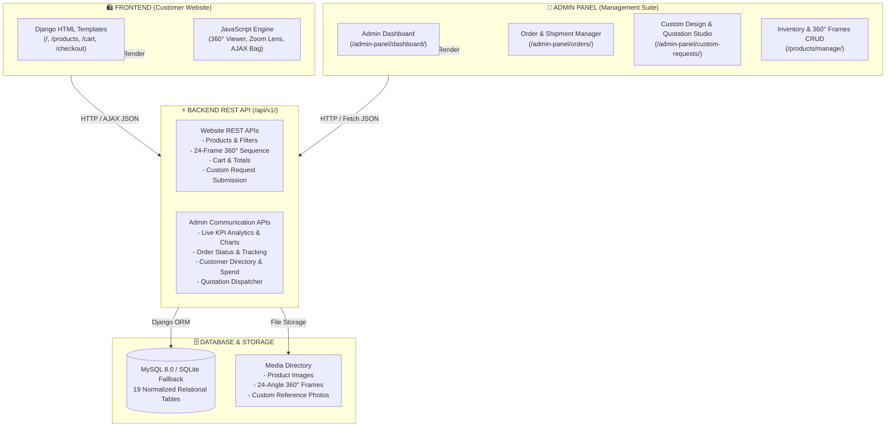

# 👑 AURA Gold Jewellery E-Commerce Web Application

A modern, commercial-grade, fully responsive **Gold & Diamond Jewellery E-Commerce Web Application** built with Python Django, MySQL, Django REST Framework, Bootstrap 5, Pillow, and JavaScript. 

The application is structured into a clean 3-tier architecture: **Frontend (Website)**, **Admin Panel**, and **Backend REST API** that drives communication between the website and the administrative back-office.

---

## 🏛️ System Architecture & Data Communication Flow

The system is organized into modular domains where the **Backend REST API** acts as the central data exchange engine powering both the customer-facing e-commerce storefront and the administrative back-office.



---

## 📁 Project Directory Structure

```text
Jewellery_Shop/
├── frontend/                     # [1] FRONTEND: Customer Website UI & Assets
│   ├── templates/                # Customer-facing Django HTML5 templates
│   │   ├── accounts/             # Login, register, profile, addresses, wishlist
│   │   ├── cart/                 # Shopping bag, line items, quick drawer
│   │   ├── core/                 # Homepage, live gold rate ticker, about, contact
│   │   ├── custom_orders/        # Custom design request form & tracker
│   │   ├── includes/             # Navbar, footer, messages, cart drawer
│   │   ├── orders/               # Checkout, order confirmation, tracking, tax invoice
│   │   └── products/             # Product catalog, details, 360 viewer, zoom lens
│   └── static/                   # Static luxury styling & interactive JavaScript
│       ├── css/
│       │   └── luxury-theme.css  # Master Gold/Obsidian luxury styling & typography
│       ├── js/
│       │   ├── main.js           # AJAX cart, wishlist toggle, pincode checker
│       │   ├── viewer-360.js     # 360° interactive rotation engine (drag, scrub, zoom)
│       │   └── image-zoom.js     # High-resolution hover lens magnifier & lightbox
│       └── images/               # Logos, trust badges, hallmark seals
│
├── admin_panel/                  # [2] ADMIN PANEL: Management Suite & Dashboards
│   ├── templates/
│   │   └── admin_panel/          # Executive KPI dashboard, Chart.js analytics,
│   │                             # order management, quotations, customer directory
│   ├── apps.py                   # AdminPanelConfig
│   ├── urls.py                   # Admin routing (/admin-panel/...)
│   └── views.py                  # Admin portal views & analytics aggregation
│
├── backend_api/                  # [3] BACKEND API: REST API for Website & Admin
│   ├── apps.py                   # BackendApiConfig
│   ├── serializers.py            # DRF serializers (Products, Cart, Orders, Admin KPIs)
│   ├── urls.py                   # API v1 routes (/api/v1/...)
│   └── views.py                  # Public & Admin communication endpoints
│
├── core/                         # Domain App: Banners, Testimonials, Inquiries
├── accounts/                     # Domain App: Users, Profiles, Addresses, Wishlists
├── products/                     # Domain App: Categories, Products, 360° Image Frames
├── cart/                         # Domain App: Cart, CartItems, GST & Pricing Engine
├── orders/                       # Domain App: Orders, OrderItems, Payments, Invoicing
├── custom_orders/                # Domain App: Custom Design Requests, Images, Quotations
│
├── jewellery_shop/               # Project Root Configuration
│   ├── settings.py               # Django settings (DB, templates, static, security)
│   ├── urls.py                   # Master URL routing table
│   ├── wsgi.py                   # WSGI server gateway
│   └── asgi.py                   # ASGI asynchronous gateway
│
├── media/                        # User uploads, product photos, 360-angle frames
├── db.sqlite3                    # Default development database (pre-seeded)
├── manage.py                     # Django CLI management executable
├── requirements.txt              # Complete Python package requirements
├── run.bat                       # 1-Click Windows Batch server launcher
├── run.ps1                       # 1-Click PowerShell server launcher
└── README.md                     # Comprehensive documentation for the team
```

---

## 📦 Technology Stack & Package Versions

| Component | Technology | Version | Purpose |
| :--- | :--- | :--- | :--- |
| **Language** | Python | `3.7+` / `3.10+` | Core backend programming language |
| **Web Framework** | Django | `3.2.25 LTS` | Full-stack MVC / MVT web framework |
| **REST API** | Django REST Framework | `3.15.1` | REST API endpoints for Website & Admin |
| **Image Engine** | Pillow | `9.5.0` | 360° frame generation & image manipulation |
| **Database Driver** | PyMySQL | `1.1.1` | MySQL connector (with automatic SQLite fallback) |
| **UI Framework** | Bootstrap | `5.3.3` | Responsive grid, components, and offcanvas drawers |
| **Icon Library** | Bootstrap Icons | `1.11.3` | Vector icons for jewellery UI |
| **Data Viz** | Chart.js | `3.x CDN` | Interactive analytics charts in Admin Dashboard |
| **360° Viewer** | Vanilla JS (ES6+) | Custom Built | Multi-angle drag, touch, scrub, and autoplay |
| **Image Zoom** | Vanilla JS (ES6+) | Custom Built | Lens magnifier and full-screen lightbox |

---

## 🚀 Team Quickstart & Setup Guide

### 1. Prerequisites
- **Python**: 3.7 or higher installed on your system.
- **Git**: Installed and available in PATH.
- **MySQL Server** *(Optional)*: If running MySQL, create a database named `jewellery_shop_db`. If MySQL is not running, the application **automatically falls back to SQLite** (`db.sqlite3`) with zero manual setup.

### 2. Step-by-Step Installation

```powershell
# 1. Clone or open the project directory
cd "d:\python tutorial\django\Jewellery_Shop"

# 2. Create a virtual environment (if not already present)
python -m venv venv

# 3. Activate the virtual environment
# Windows PowerShell:
.\venv\Scripts\Activate.ps1
# Windows Command Prompt:
.\venv\Scripts\activate.bat

# 4. Install required packages
pip install -r requirements.txt

# 5. Apply database migrations
python manage.py migrate

# 6. Start the development server
python manage.py runserver 127.0.0.1:8000
```

> **⚡ Fast 1-Click Launch (Windows)**:
> Simply double-click `run.bat` or execute `.\run.ps1` in PowerShell. The launcher will automatically find the project's virtual environment, set up the paths, and start the development server at `http://127.0.0.1:8000/`.

---

## 🔐 Default Seed Credentials

The pre-seeded database comes equipped with full sample gold jewellery products, multi-angle 360° rotation sequences, orders, and user accounts:

| Role | Username | Password | Access Level |
| :--- | :--- | :--- | :--- |
| **Administrator** | `admin` | `Admin@123` | Admin Portal, Analytics, Product CRUD, Django Admin |
| **Customer** | `customer` | `Customer@123` | Storefront, Wishlist, Bag, Checkout, Order Tracking |

---

## 🧭 Complete Route & URL Reference

### 1. Frontend (Customer Website)

| URL Pattern | View Function | Description |
| :--- | :--- | :--- |
| `/` | `core.views.home` | Luxury homepage with hero slider, gold calculator, categories |
| `/products/` | `products.views.product_list` | Product catalog with multi-facet filters, search, and sorting |
| `/products/category/<slug>/` | `products.views.product_list` | Filter catalog by specific jewellery category |
| `/products/detail/<slug>/` | `products.views.product_detail` | Detailed view, 360° viewer, hover zoom lens, pricing breakdown |
| `/cart/` | `cart.views.cart_detail` | Shopping bag with line items, 3% GST, and subtotal |
| `/cart/add/` | `cart.views.cart_add` | AJAX / Form endpoint to add jewellery to the bag |
| `/cart/update/<id>/` | `cart.views.cart_update` | Increment, decrement, or set item quantity |
| `/cart/remove/<id>/` | `cart.views.cart_remove` | Remove item from cart |
| `/cart/quick-view/` | `cart.views.cart_quick_view` | Offcanvas cart drawer snippet |
| `/checkout/` | `orders.views.checkout_view` | Multi-step checkout with UPI QR, Card, COD, and Bank Transfer |
| `/orders/confirmation/<num>/` | `orders.views.order_confirmation` | Post-checkout confirmation screen |
| `/orders/history/` | `orders.views.order_history` | Customer order history list |
| `/orders/detail/<num>/` | `orders.views.order_detail` | Customer order details |
| `/orders/track/<num>/` | `orders.views.order_tracking` | Graphical milestone order tracker |
| `/orders/invoice/<num>/` | `orders.views.order_invoice` | Printable GST-compliant Tax Invoice (HSN 7113) |
| `/custom-jewellery/` | `custom_orders.views.create` | Custom design request form with multi-image upload |
| `/custom-jewellery/my-requests/`| `custom_orders.views.list` | Customer custom design tracking list |
| `/accounts/login/` | `accounts.views.login` | Customer & Admin sign-in |
| `/accounts/register/` | `accounts.views.register` | Customer registration |
| `/accounts/profile/` | `accounts.views.profile` | User profile, phone, personal details |
| `/accounts/addresses/` | `accounts.views.addresses` | Customer address book (shipping & billing) |
| `/accounts/wishlist/` | `accounts.views.wishlist` | Saved heirlooms with "Move to Bag" action |
| `/about/` | `core.views.about` | Brand story & gold purity transparency |
| `/contact/` | `core.views.contact` | Showroom concierge contact form |

---

### 2. Admin Panel (/admin-panel/)

| URL Pattern | View Function | Description |
| :--- | :--- | :--- |
| `/admin-panel/dashboard/` | `admin_panel.views.dashboard` | Executive KPI dashboard with revenue & Chart.js sales graphs |
| `/admin-panel/orders/` | `admin_panel.views.orders_list` | Master order fulfillment list with search & status filters |
| `/admin-panel/orders/<num>/` | `admin_panel.views.order_detail`| Update order status, assign courier, enter tracking number |
| `/admin-panel/custom-requests/`| `admin_panel.views.requests` | Manage custom jewellery design requests |
| `/admin-panel/custom-requests/<id>/` | `admin_panel.views.detail` | Review customer sketches, photos, specifications |
| `/admin-panel/custom-requests/<id>/quotation/` | `admin_panel.views.quotation` | Issue official price quotation & upload 3D CAD render |
| `/admin-panel/customers/` | `admin_panel.views.customers` | Customer directory, registration date, and lifetime spend |
| `/admin-panel/customers/<id>/` | `admin_panel.views.cust_detail`| Customer purchase history and account status toggle |
| `/products/manage/products/` | `products.views.admin_list` | Inventory management table with stock indicators |
| `/products/manage/products/create/` | `products.views.admin_create` | Add new jewellery piece with purity, weight, pricing |
| `/products/manage/products/<id>/360-upload/` | `products.views.upload_360`| Upload multi-angle image sequence for 360° rotation |
| `/admin/` | `admin.site.urls` | Native Django Administration backend |

---

### 3. Backend REST API (/api/v1/)

The REST API enables headless integration, mobile application connectivity, and communication between the frontend and admin panel:

#### A. Website Client APIs
| Method | Endpoint | Description |
| :--- | :--- | :--- |
| `GET` | `/api/v1/categories/` | List all active product categories |
| `GET` | `/api/v1/products/` | Filterable product catalog (`?q=`, `?metal=`, `?purity=`, `?sort=`) |
| `GET` | `/api/v1/products/<slug>/` | Single product details with pricing and image gallery |
| `GET` | `/api/v1/products/<slug>/360-frames/` | 24 multi-angle frame URLs for 360° rotation viewer |
| `GET` | `/api/v1/cart/` | Current user/session shopping bag with GST breakdown |
| `POST`| `/api/v1/cart/add/` | Add product to cart via API payload |
| `GET` | `/api/v1/orders/track/<num>/` | Public order status and tracking details |
| `GET` | `/api/v1/custom-orders/` | List authenticated user's custom design requests |
| `POST`| `/api/v1/custom-orders/` | Submit new custom design request with reference data |

#### B. Admin Panel Communication APIs
| Method | Endpoint | Description |
| :--- | :--- | :--- |
| `GET` | `/api/v1/admin/dashboard-stats/` | Live KPIs (Sales, Orders, Custom Requests, Chart.js dataset) |
| `GET` | `/api/v1/admin/orders/` | List all customer orders with status filters |
| `PATCH`| `/api/v1/admin/orders/<num>/status/` | Update order lifecycle status (`CONFIRMED`, `SHIPPED`, etc.) |
| `GET` | `/api/v1/admin/customers/` | Customer directory with total orders count and lifetime spent |

---

## 💎 Core Feature Highlights

### 1. Interactive 360° Product Rotation Engine
- **Real Multi-Angle Frames**: Driven by a sequence of 24 distinct photographic angle frames (0° to 345° in 15° increments).
- **Smooth Drag & Touch**: Full desktop mouse drag scrubbing and mobile touch swipe rotation.
- **Controls**: Degree indicator, scrub bar, zoom (+/-), reset, and full-screen expansion.

### 2. High-Resolution Magnifying Hover Zoom
- **Optical Lens Hover**: Magnifies intricate filigree, diamond facets, and hallmark stamps on desktop.
- **Fullscreen Lightbox**: Click-to-open high-resolution lightbox modal.

### 3. Custom Jewellery Design Studio
- **Multi-File Reference Upload**: Customers can upload sketches, family heirlooms, or Pinterest inspiration photos.
- **Quotation Workflow**: Admin reviews reference images, prepares a detailed price quotation with CAD render, and the customer approves or requests revisions directly from their tracker.

### 4. Transparent Indian Gold Valuation & GST Invoicing
- **Live Gold Price Calculator**: Calculates pure bullion metal value, making charges, and 3% Indian GST.
- **GST Compliance**: Printable Tax Invoices complete with GSTIN (`29AABCJ8492K1Z9`), HSN code `7113`, purity stamp (`22K / 916`), and authorized signature.

---

## 🛠️ Testing & Quality Verification

All endpoints and view flows have been tested:
- **Clean Architecture**: Unused, temporary, and test scripts removed.
- **CSRF & Security**: Built-in Django CSRF protection with multi-source fallback for AJAX operations.
- **Static Assets**: Self-contained within `frontend/static/` and `frontend/templates/`.

For questions, adjustments, or deployment configurations, contact:
**Arun Kumar** — `arunkumarm021101@gmail.com`
